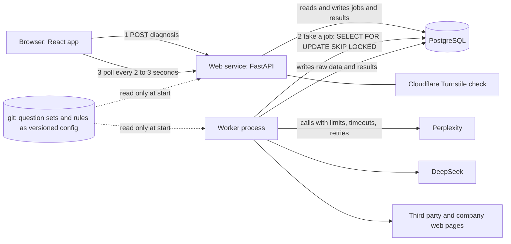

# Architecture: from prototype to production

Status: design, written 2026-10-31. Nothing in this file is built yet except where a section says
"today". The reasons for each choice are in `02_decisions.md`. The order of the work is in
`03_progress.md`, section "Next steps".

Labels used in this file:
- **[ASSUMPTION]** a number we do not know yet and guessed to size the design. Check it against real use.
- **[DECISION]** a choice that is made. Its reason is in `02_decisions.md`.
- **[PROPOSAL]** a suggestion that needs the owner's answer. All of them are collected in "Open questions".

## 1. Goals and limits

Goals:
1. A public free diagnosis that many people can run at the same time without slowing each other down.
2. The same input gives the same result on any machine at any time (requirement R4).
3. Cost under control. The paid APIs are the expensive part, not the servers.
4. Every diagnosis can be traced from one id, and its cost can be added up.
5. Everything the service needs to remember lives in PostgreSQL, not in files on the server.

Not goals for phase 1: a login system, billing, multi-region deployment, a message broker.

## 2. Expected load [ASSUMPTION]

All numbers below are guesses for the first 3 to 6 months after launch.

| Item | Estimate |
|---|---|
| Free diagnoses per month | 50 to 300 |
| Peak day | 100 to 300 diagnoses |
| Diagnoses running at the same moment | usually 1 to 3, at a peak 10 to 20 |
| Paying customers | 0 to 30 |

What one diagnosis costs today, from the code (see section 13):
- 15 Perplexity calls (one per question)
- 5 to 8 DeepSeek calls for scoring, plus 15 calls to judge topic relevance, plus a few to write the
  plain text of each result
- up to 60 third party pages fetched, plus the company's own pages
- about 1 to 3 minutes of waiting

Conclusion: at 300 diagnoses a day the whole load is about 4,500 Perplexity calls and a few thousand
page fetches a day. One small web process and one small worker process can handle that. **The
bottleneck is the cost and the rate limits of the external APIs, not the servers.** So the design
spends its effort on sharing work between diagnoses, limiting calls, and counting cost, and it does not
need Redis, Kubernetes or many servers in phase 1.

## 3. Target architecture



Parts:
- **Web service** (FastAPI). Receives a request, checks it, writes a job row, returns a diagnosis id.
  Returns the job status and the result when asked. It does no slow work. It never calls Perplexity,
  DeepSeek or a third party site.
- **Worker** (a separate process from the same code base). Takes jobs from PostgreSQL, runs the steps,
  writes everything back.
- **PostgreSQL**. The only place that holds state: the job queue, results, caches, raw data, emails,
  usage counts.
- **Git**. Holds the question sets and the rule lists as versioned files. The services only read them.

## 4. Request flow

1. The browser sends the company name, the domain, the optional competitors and a Turnstile token to
   `POST /api/diagnoses`.
2. The web service checks the input, the Turnstile token, the per IP limit and the daily total limit.
3. It looks for a finished result for the same key that is still fresh (24 hours). If there is one, it
   returns it at once with status `done`.
4. Otherwise it looks for a job with the same key that is queued or running. If there is one, it
   returns that job's id. **Nobody starts a second copy of work that is already running.**
5. Otherwise it inserts a job with status `queued` and returns `202` with the diagnosis id.
6. The browser asks `GET /api/diagnoses/{id}` every 2 to 3 seconds. The answer has the status
   (`queued`, `running`, `done`, `failed`), a short progress label, and the result when done.
7. A worker takes the job (section 5), runs the steps, writes each step's output, and sets the status.

The competitors are not part of the job key. They only change how the stored answers are counted
afterwards, which needs no external call (this is how it works today, see `competitors.py`).

### Job key [DECISION]

`job key = hash(normalized domain, normalized company name, method versions, question set version)`.

Two people who ask for the same company with the same versions share one job. A change in any version
makes a new key, so an old result is never served for a new method.

### Steps and retries

A job runs as numbered steps. Each step writes its output to PostgreSQL before the next step starts,
and writing a step is an upsert on `(job id, step)`. If a worker dies, another worker picks up the job
after a timeout and continues from the first step that has no output. Repeating a step never doubles
the cost, because the raw answers and pages it needs are already stored.

Steps: classify the company, read the AI answers, read the cited pages, read the company's own pages,
score each dimension, build the layered view and the two bar blocks, write plain text, save the result.

## 5. The queue in PostgreSQL [DECISION]

A worker takes a job like this:

```sql
SELECT id FROM diagnosis_jobs
WHERE status = 'queued' AND run_after <= now()
ORDER BY created_at
FOR UPDATE SKIP LOCKED
LIMIT 1;
```

and in the same transaction sets `status = 'running'`, `locked_by`, `heartbeat_at`. A running worker
updates `heartbeat_at` every 15 seconds. A job whose heartbeat is older than 2 minutes goes back to
`queued` with `attempts` plus one. After 3 attempts the job is `failed` with a plain reason.

At 300 jobs a day this is a tiny load for PostgreSQL. It also means one fewer service to run, and the
job and its data change in one transaction.

## 6. Data in PostgreSQL

Names are a plan, not final. Migrations are written with Alembic; code uses SQLAlchemy 2 (see decisions).

| Table | Holds | Notes |
|---|---|---|
| `diagnosis_jobs` | one row per job: key, company, domain, status, step, progress label, attempts, heartbeat, error reason, created and finished times | unique index on the key for queued or running jobs |
| `diagnosis_results` | the finished response as JSON, the key, method versions, question set version, `created_at` | one fresh row per key per 24 hours; old rows stay |
| `industry_answers` | one Perplexity answer per `(category, question set version, question index, answer date)`: text, citations, `fetched_at` | shared by all companies in the category (section 7) |
| `page_cache` | one row per normalized URL and fetch time: status, title, extracted text, content hash | shared by all companies; fresh for 7 days |
| `raw_ai_responses` | the raw reply of every Perplexity and DeepSeek call, compressed | append only |
| `raw_pages` | the raw page body of every fetch, compressed | append only |
| `judgments` | cached model judgments keyed by a hash of the input (replaces the files in `state/judgments/`) | no expiry, a new input is a new key |
| `company_categories` | which category a domain belongs to and why (replaces `state/company_categories.json`) | written once per company |
| `leads` | email, company, domain, time (replaces `data/leads.json`) | email format and length checked |
| `api_call_log` | one row per external call: diagnosis id, provider, purpose, duration, status, size, estimated cost | used for cost reports and the daily limit |
| `usage_counters` | counts per day and per key: IP, email, provider, total | used for abuse limits and the daily cap |

Rules for the data:
- Raw tables are only inserted into, never updated. A recalculation reads them and writes a new result.
- Every row carries the diagnosis id that created it where there is one.
- Timestamps are `timestamptz` in UTC.

## 7. Sharing work between companies [DECISION]

### Industry answers

The question sets contain no company name. So the 15 answers Perplexity gives for one category on one
day are the same questions for every company in that category. We store them once and share them:

- key: `(category, question set version, question index, UTC date)`
- the first diagnosis of the day for a category fetches the 15 answers; every later one reads them
- each company is then checked against the stored answers (mention rule, competitor counts, source
  list). That is local work with no API call, except the rare model call for ordinary word names, which
  is stored in `judgments`

This makes the numbers of two companies in one category on one day come from exactly the same
answers, which is also fairer for comparison. It cuts Perplexity calls from 15 per diagnosis to 15 per
category per day.

### Pages

A page cited by AI is the same page for every company. `page_cache` stores the extracted text once; the
question "does this page mention company X" is answered from the stored text. Pages are fresh for 7
days. A company's own pages are a special case: see Open questions.

### Cache times [DECISION]

| What | Fresh for |
|---|---|
| Industry answers | 24 hours (one UTC day bucket) |
| Third party pages | 7 days |
| Finished diagnosis | 24 hours |
| Judgments | no expiry; a new input is a new key |

## 8. External calls [DECISION]

All calls to Perplexity, DeepSeek and web pages go through one small client module in `shared/`:

| Control | Rule |
|---|---|
| Concurrency | a limit per provider, set in settings (starting points: Perplexity 5, DeepSeek 5, page fetches 12, and at most 2 at once per host) |
| Timeouts | separate connect timeout and read timeout, and a total time limit per call |
| Retries | up to 3 tries with growing waits and a little randomness, only for timeouts, connection errors, `429` and `5xx`; the `Retry-After` header is respected |
| Failure | a call that still fails is recorded in `api_call_log` and the step reports it; a failed question is never silently left out of the denominator |
| Daily limit | a cap on diagnoses per day and on calls per provider per day. At the cap new requests get a plain "we are busy, try again tomorrow" answer and nothing is queued |
| Page safety | only `http` and `https`; the address must resolve to a public IP (no private ranges, no localhost, no cloud metadata address); a limit on redirects and on body size |
| Counting | every call writes `api_call_log` with the diagnosis id |

With one worker the limits are per process. With more workers the limit per worker is the total divided
by the worker count; a shared limiter in PostgreSQL comes later if needed.

## 9. Abuse protection [DECISION]

- Cloudflare Turnstile token is required to start a diagnosis. The web service verifies it with
  Cloudflare. A new token is needed per request.
- Limit per IP address per day (starting point 10) and per email per day where an email is known. The
  real client IP is taken from the proxy header the platform sets; this must be configured, never trusted
  blindly.
- A daily cap on the total number of diagnoses (section 8).
- Input checks: domain format and length, company name length, at most 5 competitors.
- CORS allows only the real front end origins from settings.

## 10. Observability

- Every diagnosis has a unique id (UUID). It is the job id.
- Logs are one JSON object per line with the diagnosis id, step, provider and duration. The id is carried
  in a context variable so that code deep inside an engine logs it without passing it around.
- `api_call_log` answers "how many calls and how much money did this diagnosis cost" and "what did we
  spend today".
- A health endpoint that checks the database. A simple metric for queue length and oldest queued job.
- Errors carry the diagnosis id so support can find them.

## 11. Question sets and rules as configuration [DECISION]

- Question sets stay in git as versioned files and are read only at run time. Changing one is a pull
  request, so it is reviewed and has a version number.
- The lists of rules (layer domain lists, page type words, known product names, level lines) stay in
  git too.
- Today a new category's question set is created while a diagnosis runs and written into `state/`. That
  is not allowed in production. The new design: if a company belongs to no known category, the job
  ends with the plain status "we do not cover this kind of company yet" and the category is added by the
  command line tool in a pull request. See Open questions.

## 12. Deployment [DECISION]

- Docker images: one for the web service, one for the worker (same code, different start command).
- A managed PostgreSQL service. The platform is chosen later; nothing in the design depends on it.
- Settings come from environment variables (`DATABASE_URL`, API keys, limits, allowed origins,
  Turnstile secret). No file on the server holds state.
- Migrations run as a separate step before a new version starts.
- CI runs the tests against a real PostgreSQL service container.

### How it grows

| When | Change |
|---|---|
| More diagnoses at once | start more worker processes |
| Queue gets long or jobs need delays and priorities | move the queue to Redis |
| Raw data gets big (see the estimate below) | move `raw_pages` bodies to object storage, keep a pointer in PostgreSQL |
| Many reads of results | add a read replica |
| Provider limits become tight | add the shared limiter in PostgreSQL, then a paid plan |

Raw data size [ASSUMPTION]: about 60 pages of 20 KB each after compression plus answers is roughly
1 to 2 MB per diagnosis. At 300 diagnoses a month that is under 1 GB a month. Page sharing makes it
smaller. Check the real number after the first month.

## 13. Local tools

`psql --version` was run on the owner's computer on 2026-10-31. The result was `command not found`: the
PostgreSQL command line tools are not installed or are not on the PATH on this machine, so no version
can be recorded. The target is a current major version of PostgreSQL as offered by the managed service
(16 or later) [PROPOSAL]. When PostgreSQL is installed locally, or a container is used for development,
write the real version here.

For reference, on the same machine: Python 3.13.12 and Node v24.13.0. CI uses Python 3.13.13 and
Node 22.

The database connection string is read from `DATABASE_URL`. `backend/.env.example` shows the shape with
fake values. No real `.env` file was read or changed for this document.

## 14. Current state and gaps

How the code works today, checked against sections 3 to 12 and the production checklist in `CLAUDE.md`.
Severity: High means it breaks or hurts a public launch. Medium means it will cause trouble under load
or makes the system hard to run. Low means it is untidy or small. The plan in `03_progress.md` says
which pull request fixes each item (the code in brackets, for example P3).

Files are under `backend/` unless another path is given. Line numbers are approximate and from the
state of main on 2026-10-31.

### 14.1 Local state files

| # | Where | Today | Why it fails in production | Fix | Severity |
|---|---|---|---|---|---|
| G1 | `diagnose_service/result_cache.py` | The 24 hour result cache is one JSON file `data/result_cache.json` with every domain in it. Every read opens and parses the whole file. Every write reads the file, changes it and writes it all back | A container's disk disappears at restart, so every cache entry is lost. Two web processes each have their own file. The file grows without limit and every request pays to parse it. The write truncates the file and then dumps, so a crash in the middle leaves a broken file. `fcntl` does not exist on Windows, so the "lock" does nothing there | `diagnosis_results` table; one indexed lookup | High (P3) |
| G2 | `diagnose_service/engines/_state_store.py`, `_judgment_cache.py`, `engines/relevance_engine.py` and `engines/fact_engine.py` (judgment save) | Every new model judgment is written into `state/judgments/*.json`, a directory that is committed to git. Each lookup reads the whole file | In production this writes into the code checkout: lost at restart, different on every server, and a dirty git tree. Files grow with every company. The "shared through git" idea only works for the repo owner | `judgments` table keyed by the same hash | High (P4) |
| G3 | `engines/_question_sets.py`, `engines/citation_engine.py` (`_resolve_question_set`, `generate_checked_question_set`) | A company's category and a brand new category with its 15 generated questions are written to `state/company_categories.json` and `state/question_sets.json` while a diagnosis is running | The service writes configuration into git state at run time. Two people diagnosing two new companies of one new category at once can create the category twice, because the match is decided before the lock is taken. The question set generation (several DeepSeek calls) runs inside the web request | Question sets read only from git. Category of a company in `company_categories` table. A company with no known category ends the job with a plain status; categories are added by the command line tool in a pull request | High (P4) |
| G4 | `diagnose_service/leads_store.py` | Emails are appended to `data/leads.json` with the same whole file read and rewrite as G1. The route stores the `dimensions` list that the browser sends, as the browser sends it | Personal data in a local file that is lost at restart, not backed up and not queryable. The browser can send any content to be stored. The email is a plain string, not checked | `leads` table, validated email, store the result id, not browser data | High (P3) |
| G5 | `agent_service/_cache_store.py` | Same pattern as G1 for the agent service caches | Same problems | Move to PostgreSQL with the same helpers | Medium (P9) |
| G6 | `diagnose_service/state/` directory | Mixes two things: read only configuration (question sets) and run time data (judgments, assignments) | Configuration and data have different owners and lifetimes. This is the root of G2 and G3 | Split: config stays in git, data goes to PostgreSQL | High (P4) |
| G7 | `.gitignore`d `data/` directories | Code creates `data/` next to the source (`_DATA_DIR`) | Any local folder is wrong on a platform with an ephemeral disk | Removed together with G1, G4, G5 | Medium (P3) |

### 14.2 Requests that wait for the whole diagnosis

| # | Where | Today | Why it fails | Fix | Severity |
|---|---|---|---|---|---|
| G8 | `diagnose_service/server.py`, route `diagnose` | One `POST /api/diagnose` runs all six checks and returns only when everything is done, 1 to 3 minutes | Proxies and platforms cut requests at 30 to 100 seconds. A closed browser tab loses the work after the money was spent. The user sees nothing for minutes. All work is tied to the web process | Job table, worker, `202` plus polling (P6, P7) | High |
| G9 | `server.py` (`get_cached_result` call) | The cache read is a normal blocking file read inside an `async` function | It blocks the event loop, so while it runs no other request is served, including health checks | Disappears with G1; until then `asyncio.to_thread` | Medium (P3) |
| G10 | `server.py` (`asyncio.gather`) | Five checks run together without `return_exceptions` | One unexpected error in one check fails the whole request with a 500 after the others already spent money | Each step records its own failure and the job decides (P6) | Medium |
| G11 | `engines/relevance_engine.py` (`_judge_question`, one per question, about line 457) | The topic relevance check judges 15 questions one after another, each a DeepSeek call | Adds a minute or more of latency inside the request | Run inside the worker with the provider concurrency limit; batch where the prompt allows | Medium (P6) |
| G12 | `frontend/diagnose/src/api.js` | Waits for one long request, with no time limit, no cancel and no progress | Same as G8 from the browser side. The API address is fixed to `http://localhost:8000` | Poll for status; address from build settings (P7) | High |

### 14.3 External calls: timeouts, retries, limits

| # | Where | Today | Why it fails | Fix | Severity |
|---|---|---|---|---|---|
| G13 | `engines/citation_engine.py` (`_call_perplexity`, `_post_deepseek_json`), `engines/fact_engine.py`, `engines/relevance_engine.py`, `engines/_plain_finding_generator.py`, `agent_service/*` | Every call is `requests.post` with `timeout=20` and `raise_for_status()`. No retry for `429`, `5xx` or timeouts | A single hiccup from Perplexity drops a question. The 15 answers are then 14, and the result changes for reasons that have nothing to do with the company. This also breaks the requirement that the same input gives the same result. At peak, rate limit replies are likely | One client module with retries, backoff, `Retry-After`, separate connect and read timeouts (P2) | High |
| G14 | `citation_engine.py` (`MAX_CONCURRENT_CALLS = 5`), `fact_engine.py` (3 threads), `source_layers.py` (`_FETCH_WORKERS = 12`) | Each diagnosis starts its own thread pools | The limits are per request, so they multiply: 10 diagnoses at once means up to 50 Perplexity calls and 120 page fetches at once. Nothing protects the provider limits or the third party sites. Threads from the default executor are also shared with everything else | A per provider limiter in the shared client, in the worker (P2) | High |
| G15 | `source_layers.py` (`fetch_html`), `shared/_fetch_utils.py`, `engines/evidence_engine.py`, `recency_engine.py`, `technical_engine.py`, `relevance_engine.py` | The domain typed by the user is fetched from the server as it is. Redirects are followed. There is no limit on the size of the body. There is no check of the address | **Server side request forgery.** A user can type `localhost:8000` or a private or cloud metadata address and make our server fetch it. A huge page can use all memory | Address check (public IPs only), redirect limit, size limit, in the shared client (P2) | High |
| G16 | `source_layers.py` | Up to 60 third party pages are fetched live for every diagnosis, from many hosts, with no per host limit and no use of a stored copy | A page cited by AI is fetched again for each company. Hosts can block us. Slow. | `page_cache` shared between companies, per host limit (P5) | Medium |
| G17 | all external calls | No record of calls made | Nobody can say what a diagnosis cost or why a day cost so much | `api_call_log` (P2 for the hook, P8 for the report) | High |
| G18 | the whole service | No cap on diagnoses per day, no limit per IP, no human check | One script can run thousands of diagnoses and spend the whole API budget in a day | Turnstile, per IP and daily caps (P8) | High |

### 14.4 Two users at the same time

| # | Situation | What happens today | Fix | Severity |
|---|---|---|---|---|
| G19 | Two people diagnose the same company at the same moment | Both miss the cache, both run all six checks and all external calls, and the one that finishes last overwrites the other's result. `previous_scores` can also be taken from a half written state | One job per key, the second request shares it (P6) | High |
| G20 | Two people diagnose two companies of the same category | The 15 Perplexity answers are fetched twice, and the two companies may be measured on different answers | Shared industry answers (P5) | Medium |
| G21 | Two new companies of one new category at the same moment | Two question sets can be generated and stored; see G3 | Question sets are not created at run time (P4) | High |
| G22 | Same company, two different competitor lists at once | The cache entry of one request is replaced by the other's list. The numbers stay right but the stored list flips | Competitors are applied per request and not stored in the shared result (P6) | Low |
| G23 | Many people at once | The web process does the work. Its thread pool is shared by all requests, and a handful of diagnoses use all threads, so even cheap requests wait | Worker process, web service only enqueues and reads (P6) | High |

### 14.5 Idempotency, logging, tests

| # | Where | Today | Why it fails | Fix | Severity |
|---|---|---|---|---|---|
| G24 | the whole service | Only two `logger.exception` calls. No request id, no diagnosis id, no structured logs | A customer report "my result looked wrong yesterday" cannot be traced | Diagnosis id in a context variable, JSON logs (P2) | High |
| G25 | `server.py` | A repeated POST runs the whole diagnosis again | A double click, a retry by the browser or a proxy costs twice | Job key and sharing (P6) | Medium |
| G26 | `models.py`, `server.py` | `domain` and `company_name` are plain strings with no format or length limit. The lead `email` is a plain string. CORS lists four localhost addresses in code | Bad input reaches the engines. The real front end cannot call the API once deployed | Validation, origins from settings (P1) | Medium |
| G27 | tests | 384 backend tests and 104 front end tests, all offline with mocks, which is good. There are no tests for database code, for two things running at once, or for a worker that dies in the middle | The new parts are exactly the risky ones | Tests with a real PostgreSQL in CI; tests for duplicate jobs, crash and retry, rate limits and daily caps (every PR in the plan) | Medium |
| G28 | `.github/workflows/ci.yml` | No PostgreSQL service, no migration check, no image build | The new code could pass CI and not start | Add the service container and a migration step (P3) | Medium |

### 14.6 Reproducibility in the new design

| # | Where | Today | Risk | Fix | Severity |
|---|---|---|---|---|---|
| G29 | stored judgments and category assignments | Shared between machines by git | In the database design a developer's local database has different judgments than production, so the same input could differ between a laptop and production | Production is the source of truth. A script exports judgments and answers from a run so a result can be recalculated offline from stored raw data (P5, P9) | Medium |
| G30 | AI answers | Fetched live and kept only inside the 24 hour result | A result cannot be recalculated later from the same answers | `raw_ai_responses`, `industry_answers` (P5) | Medium |

### 14.7 Scripts

| # | Where | Today | Problem | Fix | Severity |
|---|---|---|---|---|---|
| G31 | `scripts/batch_diagnose.py` | Calls each engine directly, one company after another. It builds the six dimensions and the provenance but not the layered view, the source bars or the website readiness that the live route now returns. It writes `output/results.jsonl` locally. Engines still write judgments to `state/` while it runs | The batch result is no longer the same shape as the live result. When judgments move to PostgreSQL it will need a database or fail | Call one shared function `run_diagnosis(...)` that the worker also uses, with a switch for "no database" (in memory repository) (P9) | Medium |
| G32 | `scripts/stability_audit.py` | Patches `get_cached_judgment` and `save_judgment` in two engines to bypass the cache | Those functions will move. The patch breaks silently or the audit stops measuring what it says | Bypass through the repository interface, not by patching names (P9) | Medium |
| G33 | `scripts/question_sets.py` | The command line tool that creates, extends and refreshes question sets and writes into `state/` | This tool is right: question sets are configuration. It must keep working and must also be the only way a category is added | Keep. Add a command that registers a category and prints the file changes for a pull request (P4) | Low |

### 14.8 Smaller things

| # | Where | Today | Problem | Fix | Severity |
|---|---|---|---|---|---|
| G35 | `docs/source_layers_known_limits.md` | Says each question is asked 3 times and the sample is about 5 questions | Out of date since the 15 questions asked once | Update (P1) | Low |
| G36 | `frontend/diagnose/src/utils/provenance.js` and its tests | No longer used by any component after the score change note was removed | Dead code | Remove or reuse (P7) | Low |
| G37 | `engines/citation_engine.py` (`KNOWN_PRODUCT_NAMES`) | A list of product names written by hand | It will always be incomplete. The question generator is told not to name products, and the checker catches the listed ones | Keep, extend when a miss is found | Low |
| G38 | `competitors.py`, `result_cache.py` | The cache key is the domain only, so the company name typed is ignored when a fresh result exists | Two spellings of one company share a result, which is probably fine, but it is not a stated rule | State the rule in the key (job key, section 4) | Low |
| G39 | `backend/shared/config.py` | Reads the environment once at import; `request_timeout_seconds` is a single number | Cannot tune per provider | Per provider settings (P2) | Low |

Totals: High 16, Medium 15, Low 7, 38 items (G1 to G39; G34 was removed because it needed no change, so its number is not used).

## 15. Open questions for the owner

1. **New categories at run time.** Section 11 says the service no longer creates a question set while a
   diagnosis runs. A company in a category we do not cover would get a plain "not covered yet" answer
   and the category would be added by you in a pull request. Is that acceptable for launch, or do you
   want a waiting list that notifies the person when the category is added?
2. **Freshness of the company's own pages.** Third party pages are cached for 7 days. If the company's own
   pages are cached 7 days too, a customer who fixes their site and runs again within a week sees no
   change. [PROPOSAL] Cache the company's own pages for 24 hours only, like the result.
3. **Day bucket for industry answers.** [PROPOSAL] The bucket is the UTC date. A diagnosis made just
   after midnight UTC fetches new answers. If you prefer a rolling 24 hours, results of two companies
   in one category may then come from different answers.
4. **Daily limits.** Starting values for the daily diagnosis cap, the per IP limit and the provider caps
   need a budget from you. This design only says there must be a cap.
5. **Email at submit.** The limit per email needs an email before the diagnosis starts. Today the email is
   asked only to unlock the details. Do you want to ask for it earlier?
6. **`docs/product_positioning.md`.** It was not found in the repository or in the working folders when this
   document was written. The pull request therefore does not contain it. Please add it; the reading rule
   in `CLAUDE.md` is already in place.
